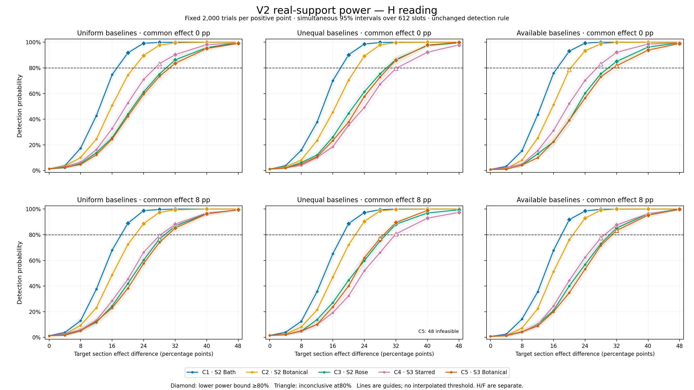
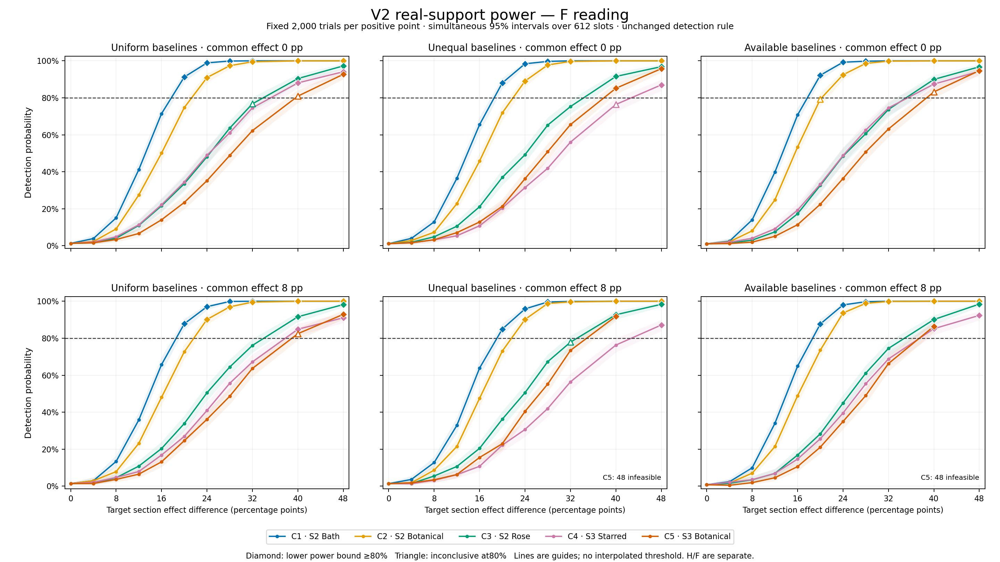

RETROSPECTIVE REAL-SUPPORT POWER STUDY — unchanged V2; no manuscript rescoring.

The first sustained certified tested differences below meet the80% lower-bound criterion across all three baseline architectures, separately within each reading. They are grid points, not interpolated minimum detectable effects. All larger jointly feasible tested points also qualify.

| Target context | H, common0 | F, common0 | H, common+8 | F, common+8 |
|---|---|---|---|---|
| C1 · Scribe2 Bath | +20 pp | +20 pp | +20 pp | +20 pp |
| C2 · Scribe2 Botanical | +24 pp | +24 pp | +24 pp | +24 pp |
| C3 · Scribe2 Rose | +32 pp | +40 pp | +32 pp | +40 pp |
| C4 · Scribe3 Starred | +40 pp | +48 pp | +40 pp | +48 pp |
| C5 · Scribe3 Botanical | +40 pp | +48 pp | +40 pp | Not certified |

Every +12-point scenario was below the80% target: power estimates ranged4.55%–43.65%. This is a conditional sensitivity result, not a bound on true manuscript heterogeneity.

C5 on the+8-point background has no cross-baseline certification in F within the jointly feasible grid. Its uniform-baseline+40-point estimate is82.45%, but the simultaneous interval78.90%–85.65% straddles80%; +48 is infeasible in the unequal and availability-preserving scenarios. Each individual curve is retained; “not certified” does not mean detection is impossible.

All12 zero guards passed;18 power cells remain INCONCLUSIVE, and3 cells are INFEASIBLE. No additional trials or probability clipping was used. The charts were visually inspected with H/F separate; PNG and SVG exports retain the full curves and simultaneous intervals.

Completed 1,314,000 unique fixed synthetic trials:2,000 per feasible positive point and10,000 per zero guard. All 12 guards and all effect positions are retained. The grid has612 slots; 3 infeasible cells received no draws and still occupy confidence-family slots. No sample extension, grid refinement, isotonic fit, interpolation or retuning occurred.

A section-effect difference is an extra sh–ch risk difference in the target context relative to its same-scribe peers. Each target C1–C5 is shifted separately. The common background effect is0 or+8 percentage points. Baselines are uniform, section-specific unequal, or availability-preserving. H/F remain alternate readings and were never pooled.

Reliability requires the simultaneous exact Clopper–Pearson LOWER bound≥80%. UPPER<80% is below target; otherwise INCONCLUSIVE. These612 intervals jointly have at least95% coverage under the independent-trial simulation model; infeasible slots keep the family size conservative. The detection rule is unchanged V2 rawp≤.025 (conservative Holm2p≤.05).

Status counts: {"BELOW 80% TARGET": 369, "GUARD PASS": 12, "INCONCLUSIVE": 18, "INFEASIBLE": 3, "RELIABLY DETECTABLE": 210}.

Zero guard results: 12/12 pass. Each guard is shared across the matching five target curves, not five independent repetitions. If a guard fails/is inconclusive, its curves cannot receive reliability certification; raw power estimates remain visible.

A compact summary below requires certified≥80% MARGINAL power in each reading and each of the three baseline architectures. It does not assert80% joint H-and-F detection probability. “Sustained” requires every larger jointly feasible tested grid point to qualify; points between grid values were not simulated.

| Common background effect | Target | First certified tested difference across H/F and all baselines | First sustained certified tested difference | Largest jointly feasible tested difference |
|---|---|---|---|---|
| 0 pp | C1 · S2 Bath | 20 pp | 20 pp | 48 pp |
| 0 pp | C2 · S2 Botanical | 24 pp | 24 pp | 48 pp |
| 0 pp | C3 · S2 Rose | 40 pp | 40 pp | 48 pp |
| 0 pp | C4 · S3 Starred | 48 pp | 48 pp | 48 pp |
| 0 pp | C5 · S3 Botanical | 48 pp | 48 pp | 48 pp |
| 8 pp | C1 · S2 Bath | 20 pp | 20 pp | 48 pp |
| 8 pp | C2 · S2 Botanical | 24 pp | 24 pp | 48 pp |
| 8 pp | C3 · S2 Rose | 40 pp | 40 pp | 48 pp |
| 8 pp | C4 · S3 Starred | 48 pp | 48 pp | 48 pp |
| 8 pp | C5 · S3 Botanical | None certified | None certified | 40 pp |

All60 individual curves retain their own thresholds in CURVE-THRESHOLDS.json. An absent certified point means no tested magnitude met the criterion under that scenario, not impossibility at every larger untested effect. INCONCLUSIVE cells are retained in POWER-CELLS.csv and RESULTS.json; they are neither rounded up to reliable nor declared below target.

| Reading | Architecture | Common | Target | Difference | Power [simultaneous CI] |
|---|---|---|---|---|---|
| H | uniform | 0 pp | C4 | 28 pp | 83.2% [79.7%,86.3%] |
| H | uniform | 8 pp | C3 | 28 pp | 76.6% [72.8%,80.3%] |
| H | uniform | 8 pp | C4 | 28 pp | 79.3% [75.6%,82.7%] |
| H | unequal | 0 pp | C4 | 32 pp | 79.5% [75.8%,83.0%] |
| H | unequal | 8 pp | C4 | 32 pp | 80.6% [76.9%,83.9%] |
| H | unequal | 8 pp | C5 | 28 pp | 77.1% [73.3%,80.7%] |
| H | available | 0 pp | C2 | 20 pp | 78.6% [74.9%,82.1%] |
| H | available | 0 pp | C4 | 28 pp | 83.0% [79.5%,86.2%] |
| H | available | 0 pp | C5 | 32 pp | 81.7% [78.1%,84.9%] |
| H | available | 8 pp | C4 | 28 pp | 77.6% [73.8%,81.1%] |
| H | available | 8 pp | C5 | 32 pp | 83.3% [79.8%,86.4%] |
| F | uniform | 0 pp | C3 | 32 pp | 76.8% [72.9%,80.3%] |
| F | uniform | 0 pp | C5 | 40 pp | 80.9% [77.3%,84.2%] |
| F | uniform | 8 pp | C5 | 40 pp | 82.5% [78.9%,85.6%] |
| F | unequal | 0 pp | C4 | 40 pp | 76.4% [72.5%,80.0%] |
| F | unequal | 8 pp | C3 | 32 pp | 77.8% [74.0%,81.4%] |
| F | available | 0 pp | C2 | 20 pp | 79.2% [75.5%,82.7%] |
| F | available | 0 pp | C5 | 40 pp | 83.2% [79.7%,86.3%] |

Infeasible cells:

- H unequal, common8 pp, C5 difference48 pp; proposed probability range[0.1, 1.01]. No clipping or replacement generator was used.
- F unequal, common8 pp, C5 difference48 pp; proposed probability range[0.1, 1.01]. No clipping or replacement generator was used.
- F available, common8 pp, C5 difference48 pp; proposed probability range[0.0, 1.0711213901246937]. No clipping or replacement generator was used.

The figures connect measured grid points only as visual guides; their bands are simultaneous intervals. Diamonds denote reliable grid points and triangles denote inconclusive points. A probability boundary/infeasible point is not a zero-power observation. The PNGs and SVGs are standalone scientific figures.

This study estimates operating characteristics conditional on unchanged real geometry and the specified synthetic generators. It is not a confidence bound on the actual manuscript’s unknown heterogeneity and does not convert the earlier no-detection result into proof of uniform strength. Baselines, background association, target position, folio imbalance and sparse contexts matter. Original context selection and exposed material remain. No new manuscript statistic, p-value, semantics or mechanism is inferred.

PRESERVATION.json inventories all prior non-cache files. PROTOCOL.json and PHASES.jsonl freeze the grid, generator feasibility, support and results. Every synthetic hit/miss has a coordinate, seed, outcome hash and V2 statistic in trials/. POSTRUN-AUDIT.json records fixed first/middle/last checks per feasible cell and every zero-guard false flag, using independent scalar arithmetic. FINAL-VERIFICATION.json records final artifact hashes and preservation checks.
