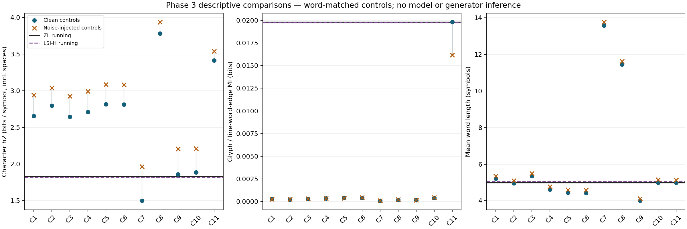
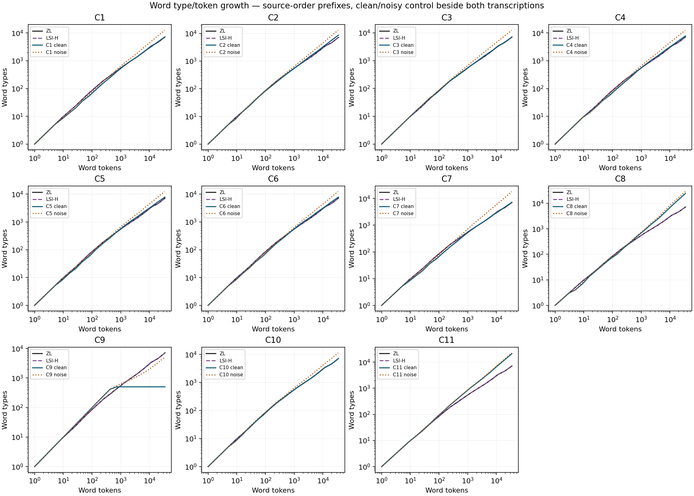

# Voynich pattern-model lab — Phase 3 checkpoint

**STOP: Phases 1, 2 and 3 complete. No model training, probes, fingerprint classification or Phase 5 analyses have run.**

Run `phase3-20261026T151713515914Z`; seed 1729. Primary ZL ordinary running paragraphs; LSI-H robustness corpus remains separate. Labels and free-floating Pb text have separate files.

## Paragraph-position repair

The old parser erased a running paragraph’s state whenever it encountered a label. The repair preserves explicit paragraph state across intervening non-paragraph loci. No source text changed.

Original missing positions: 1,329. Dispositions: {'nonparagraph_not_applicable': 1255, 'recovered_intervening_label_reset': 61, 'unmarked_free_floating_Pb_separate': 13}. Primary missing positions after repair: **0**.

| is_label | Section | Originally missing loci |
|---|---|---:|
| False | astronomical | 71 |
| False | biological | 20 |
| False | cosmological | 122 |
| False | herbal | 25 |
| False | text_only | 26 |
| False | zodiac | 36 |
| True | astronomical | 116 |
| True | biological | 116 |
| True | cosmological | 172 |
| True | herbal | 32 |
| True | pharmaceutical | 234 |
| True | text_only | 60 |
| True | zodiac | 299 |

The 13 still-unmarked paragraph-type loci are Pb (free-floating blocks), not ordinary running paragraphs. All 134 Pb loci are retained separately, including marked ones; none are silently reclassified as labels. Primary running types are P0/P1/Pc/Pr/Pt. C/R diagram text also remains outside the primary corpus. Full original 1,329-locus audit is in paragraph_missing_loci.csv.

## Corpora and matching

All clean controls match the primary **word count exactly**; source words are never repeated to fill a short corpus. Noise variants use the paired clean corpus without resampling. EVA-character ratios are disclosed, not forced to match. Layout uses the same word slots, pages and paragraph flags as ZL; original language lines/paragraphs are not preserved. This tests lexical/order structure under matched layout, not natural manuscript line-breaking behavior.

| Control | Version | Words | Word ratio | Characters | EVA-character ratio | Alphabet |
|---|---|---:|---:|---:|---:|---:|
| C1 | clean | 34509 | 1.0000 | 179783 | 1.0436 | 26 |
| C1 | noise | 33691 | 0.9763 | 180431 | 1.0473 | 26 |
| C2 | clean | 34509 | 1.0000 | 171151 | 0.9934 | 26 |
| C2 | noise | 33675 | 0.9758 | 171935 | 0.9980 | 26 |
| C3 | clean | 34509 | 1.0000 | 184612 | 1.0716 | 26 |
| C3 | noise | 33717 | 0.9770 | 185237 | 1.0752 | 26 |
| C4 | clean | 34509 | 1.0000 | 159294 | 0.9246 | 34 |
| C4 | noise | 33604 | 0.9738 | 160126 | 0.9295 | 34 |
| C5 | clean | 34509 | 1.0000 | 153147 | 0.8889 | 34 |
| C5 | noise | 33529 | 0.9716 | 154045 | 0.8942 | 34 |
| C6 | clean | 34509 | 1.0000 | 152795 | 0.8869 | 34 |
| C6 | noise | 33537 | 0.9718 | 153595 | 0.8915 | 34 |
| C7 | clean | 34509 | 1.0000 | 468368 | 2.7186 | 24 |
| C7 | noise | 34066 | 0.9872 | 468845 | 2.7214 | 24 |
| C8 | clean | 34509 | 1.0000 | 395055 | 2.2931 | 24 |
| C8 | noise | 34027 | 0.9860 | 395462 | 2.2955 | 24 |
| C9 | clean | 34509 | 1.0000 | 138028 | 0.8012 | 15 |
| C9 | noise | 33663 | 0.9755 | 138697 | 0.8051 | 15 |
| C10 | clean | 34509 | 1.0000 | 172280 | 1.0000 | 26 |
| C10 | noise | 33670 | 0.9757 | 173068 | 1.0046 | 26 |
| C11 | clean | 34509 | 1.0000 | 172280 | 1.0000 | 26 |
| C11 | noise | 33689 | 0.9762 | 173053 | 1.0045 | 26 |

C1=Hildegard Latin medical prose (1903 edition); C2=Mattioli Italian herbal (1568); C3=Bock German herbal (1595). C4–C6 are parameterized schematic scribal/shorthand/astro encoders of C1. C7=fixed verbose cipher of C1. C8=simplified recent-word copying/mutation; C9=simplified table/grille. C10=page-local word shuffle; C11=within-word character shuffle. C8/C9 are style controls, not replications of published implementations. SOURCES.md records provenance, byte hashes and failed retrievals.

Clean historical controls contain uncorrected OCR. Alphabet relabeling is injective and preserves counts/structure; actual alphabet sizes are reported. Cardinalities are comparable, not identical: there is residual alphabet-size confounding, so raw entropy alone cannot identify a generator. The normalized entropy column is descriptive and does not eliminate this confound.

## Noise calibration

Eligible historical line-pairs reproduce Phase 0’s 33,785 edit operations / 790,720 denominator = **4.2727%**. Fixed symmetric rates: substitution **2.1596%**, insertion **1.0566%**, deletion **1.0566%**.

Traceback ties choose diagonal, deletion, insertion. Insertion/deletion orientation is averaged because neither transcriber is truth. The IID sensitivity channel edits existing characters including spaces; no newline edits. Inserted/substituted symbols are uniform over that control’s alphabet plus one space; substitutions cannot equal the input. Single-pass mutually exclusive operations; output whitespace is canonicalized, with raw pre-normalization strings saved. Attempted operation rates and normalization counts are in noise_realized.json. This is not a fitted historical corruption process or a literal per-transcription error rate.

## Frozen tokenizations and metric definitions

T1=EVA code point/normalized control symbol, including spaces. T2=longest configured EVA cluster for ZL/LSI; controls use 13 greedy BPE pair merges learned only from clean control training pages, then reused on its noisy version. T3=space-delimited word. BPE stays inside words. Splits group all manuscript sides/panels of a leaf into the same 80/10/10 partition; models have not run. Every merge/codebook/config is saved.

h0=H(X), h1=H(next|previous), h2=H(next|previous two), empirical plug-in bits per token. No transitions cross loci. The headline character h2 is T1; T2/T3 are cluster/word entropies, not character entropies. Entropies use UNK as a symbol. Space/no-space conventions matter. No bias correction: sparse contexts, especially T3, can depress conditional entropy. Support counts accompany estimates.

Zipf uses all token types in log-rank/log-frequency regression. Hapax ratio is singleton types / all types. Word-length mean/variance/skewness/excess kurtosis and growth curves are supplied. Glyph MI uses first/interior/last/both word positions within lines, first/interior/last/single glyph positions within words, and explicit paragraph-start vs continuation; null starts are excluded. Identical and edit-distance-exactly-1 repetition rates use adjacent words within a locus. The glyph/word metrics repeat across tokenizations by design.

## Master measurements: every corpus beside the controls

The full one-table output is master_metrics.csv (all metrics, tokenizations, primary, LSI-H, separate labels/Pb, A/B subsets, clean/noisy controls). This display highlights character entropy and shared structural measurements; it is not a significance test.

| Corpus | T1 h0 | T1 h1 | **T1 h2** | Word length mean | Line-edge MI | Paragraph-start MI | Edit-1 repetition |
|---|---:|---:|---:|---:|---:|---:|---:|
| ZL_running | 3.9040 | 2.1173 | 1.8290 | 4.9923 | 0.0198 | 0.0151 | 0.0361 |
| LSI_H_running | 3.8985 | 2.1104 | 1.8164 | 5.0644 | 0.0197 | NA | 0.0344 |
| ZL_labels | 3.8969 | 2.5979 | 2.1088 | 5.2677 | 0.0251 | NA | 0.0412 |
| LSI_H_labels | 3.8639 | 2.6124 | 2.1004 | 5.1243 | 0.0317 | NA | 0.0368 |
| ZL_free_floating_Pb | 3.9509 | 2.1227 | 1.6442 | 5.0247 | 0.0487 | 0.0102 | 0.0255 |
| ZL_running_A | 3.8769 | 2.1674 | 1.8701 | 4.7996 | 0.0214 | 0.0166 | 0.0407 |
| ZL_running_B | 3.8987 | 1.9965 | 1.7076 | 5.0893 | 0.0234 | 0.0156 | 0.0339 |
| LSI_H_running_A | 3.8679 | 2.1482 | 1.8534 | 4.8785 | 0.0213 | NA | 0.0393 |
| LSI_H_running_B | 3.8949 | 1.9946 | 1.6978 | 5.1564 | 0.0236 | NA | 0.0322 |
| C1_clean | 4.0024 | 3.3109 | 2.6579 | 5.2097 | 0.0003 | 0.0001 | 0.0065 |
| C1_noise | 4.0691 | 3.4927 | 2.9396 | 5.3555 | 0.0003 | 0.0001 | 0.0057 |
| C2_clean | 3.9432 | 3.2148 | 2.7976 | 4.9596 | 0.0002 | 0.0002 | 0.0108 |
| C2_noise | 4.0164 | 3.4045 | 3.0383 | 5.1057 | 0.0003 | 0.0002 | 0.0101 |
| C3_clean | 4.1790 | 3.2857 | 2.6457 | 5.3497 | 0.0003 | 0.0002 | 0.0056 |
| C3_noise | 4.2211 | 3.4745 | 2.9263 | 5.4939 | 0.0003 | 0.0002 | 0.0056 |
| C4_clean | 4.1938 | 3.3708 | 2.7115 | 4.6160 | 0.0004 | 0.0001 | 0.0066 |
| C4_noise | 4.2731 | 3.5906 | 2.9933 | 4.7651 | 0.0004 | 0.0001 | 0.0058 |
| C5_clean | 4.2863 | 3.4195 | 2.8163 | 4.4379 | 0.0004 | 0.0002 | 0.0130 |
| C5_noise | 4.3554 | 3.6413 | 3.0868 | 4.5944 | 0.0004 | 0.0002 | 0.0126 |
| C6_clean | 4.2885 | 3.4145 | 2.8120 | 4.4277 | 0.0004 | 0.0001 | 0.0131 |
| C6_noise | 4.3542 | 3.6353 | 3.0806 | 4.5799 | 0.0004 | 0.0001 | 0.0129 |
| C7_clean | 3.9737 | 2.3707 | 1.4980 | 13.5723 | 0.0001 | 0.0000 | 0.0000 |
| C7_noise | 4.0297 | 2.6958 | 1.9627 | 13.7628 | 0.0001 | 0.0000 | 0.0001 |
| C8_clean | 4.6077 | 4.4703 | 3.7805 | 11.4479 | 0.0002 | 0.0005 | 0.0191 |
| C8_noise | 4.6100 | 4.4904 | 3.9371 | 11.6220 | 0.0002 | 0.0004 | 0.0116 |
| C9_clean | 3.7592 | 2.2115 | 1.8581 | 3.9998 | 0.0002 | 0.0001 | 0.0408 |
| C9_noise | 3.7770 | 2.5307 | 2.2051 | 4.1202 | 0.0002 | 0.0001 | 0.0308 |
| C10_clean | 3.9040 | 2.1275 | 1.8856 | 4.9923 | 0.0004 | 0.0002 | 0.0254 |
| C10_noise | 3.9885 | 2.4666 | 2.2088 | 5.1401 | 0.0005 | 0.0001 | 0.0200 |
| C11_clean | 3.9040 | 3.6498 | 3.4142 | 4.9923 | 0.0198 | 0.0151 | 0.0081 |
| C11_noise | 3.9892 | 3.7640 | 3.5383 | 5.1368 | 0.0162 | 0.0120 | 0.0076 |

## Eligibility and interpretation

Unknown Currier-language exclusions from A/B: {'ZL_running': 49, 'LSI_H_running': 49}. Never imputed. Overall corpora retain those loci. Control A/B comparisons at this checkpoint use the same full control baselines; controls have no authentic Currier assignment. No A/B-specific generator inference is made.

Scribe/hand and paragraph-position probes are registered as ZL-only. LSI-H has no explicit paragraph-start markers here; its paragraph-start MI is NA, not zero. Labels/Pb have different lengths/coverage from the running controls: those rows are inventories, not matched label-effect evidence.

## What this does NOT show

These measurements do not translate or decipher Voynich, identify its language or generator, establish medieval shorthand authenticity, or distinguish a broad historical generator class from one schematic control. No nearest-control ranking, significance claim or “dramatic” finding is asserted. Noise is a sensitivity channel and historical OCR is an uncontrolled additional source of variation. Matching word counts cannot simultaneously equalize character budgets when word lengths differ.

Model-free measures alone do not test line-position embedding gain. Model comparisons, five-seed variance, alternate-transcription confirmation of any proposed dramatic finding, shorthand sweeps, classifier validation, surprise maps and probes remain for later phases. Further inference requires those checks and matched controls.

Verification and run receipts are in runs/. DECISIONS.md freezes all judgment calls. Proceed no further until this Phase 3 checkpoint is accepted.
