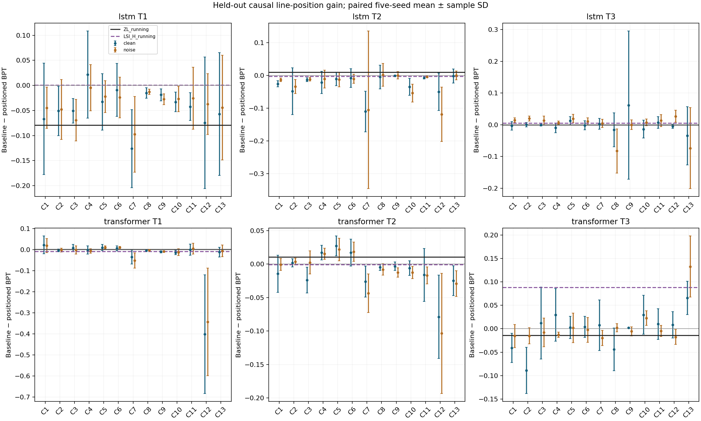
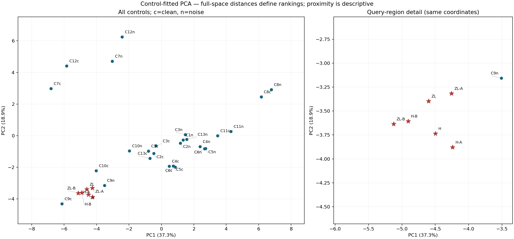
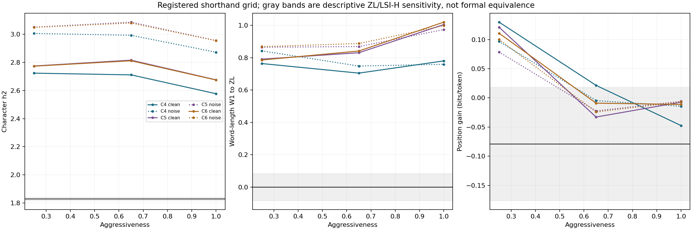
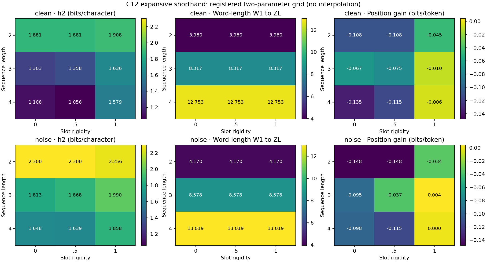
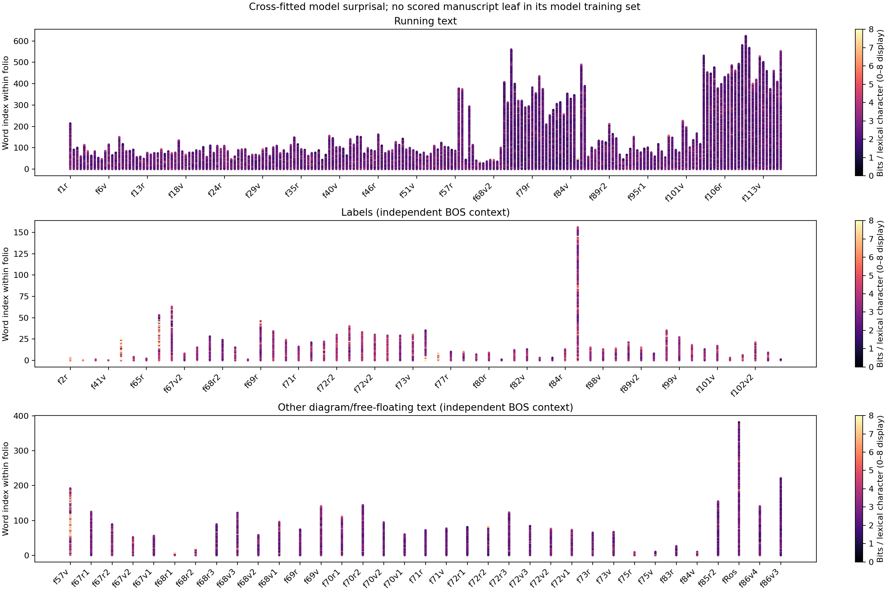

# Voynich pattern-model pipeline — Phase 5 report

**COMPLETE AND STOPPED AFTER PHASE 5. No translation or decipherment was attempted.**

Experiment: `phase5-c2f38fa45d6b`. Phase 4 contains 1,680 registered fits, five seeds for every corpus/tokenization/architecture/position condition. All models fit below 5M parameters and ran locally on the RTX 5060.

**Qualification limit:** these are fixed-compute instruments (96 optimization steps, 32×64 sampled blocks), not convergence-qualified models. The final checkpoint attained the best observed validation loss in 88.1% of main fits. Effective epoch counts, vocabulary coverage and curves are saved. Model differences, fingerprints and probe accuracies remain conditional on this budget and representation.

## Data, provenance and transcription sensitivity

Primary: ZL ordinary running paragraph text, 3,996 loci / **34,509 words / 172,280 nonspace EVA characters**. Alternate: LSI transcriber H alone, never pooled. Labels and other diagram/free-floating text remain separate. Sources, byte hashes and retrieval failures are in [SOURCES.md](../SOURCES.md); all choices/corrections are in [DECISIONS.md](../DECISIONS.md).

Historical pairwise agreement: **95.7273%**; disagreement: **4.2727%**, 33,785 edits / 790,720 normalized character positions, from 19,741 eligible LSI line-pairs. This is transcription sensitivity, not ground-truth error or a quantity in model bits/token. Pairwise operation reconstruction gives 2.1596% substitutions and symmetric 1.0566% insertion/deletion rates.

The 1,329 original missing paragraph positions were fully accounted for: {'nonparagraph_not_applicable': 1255, 'recovered_intervening_label_reset': 61, 'unmarked_free_floating_Pb_separate': 13}. Sixty-one ordinary paragraph positions were recovered by preserving state across interleaved labels; no primary positions remain missing. Thirteen unmarked Pb loci remain unknown in the separate free-floating corpus. [Full audit](paragraph_missing_loci.csv).

## Controls, tokenization and the extended Phase 3 summary

C1 Latin medical prose; C2 Italian herbal; C3 German herbal; C4 scribal abbreviation; C5 shorthand; C6 astro-mixed shorthand; C7 verbose cipher; C8 simplified recent-word copying; C9 simplified table/grille; C10 page-local word shuffle; C11 within-word character shuffle; C12 expansive shorthand; C13 authentic manuscript lineation. Every control has clean and noise-injected versions.

C12 uses C5, then decomposes every atomic sign into a fixed multi-stroke sequence. Length and slot rigidity are explicit parameters. A pre-C12-training counterfactual test caught constant nominally-variable slots; the corrected encoder uses independent permutations in variable slots. Earlier C12 snapshots are preserved and superseded. No C12 neural model used the faulty encoder.

C13 is the CC0 diplomatic transcription of SBB-PK Ms. germ. fol. 516 (c.1457–1460): **2,252 authentic lines, 36 available pages, 11,056 word fragments**. Its original image-coordinate line records, abbreviations and cross-line fragments are preserved. It is shorter than ZL and differs in genre, language and transcription conventions; it is explicitly not word-count matched. Six deleted words caught in parser validation were removed before training.

Other clean controls match the primary word count exactly and use its word-slot layout. Noise can alter word count slightly; every C1–C12 noisy variant remains within the registered tolerance. [Word/character matching table](size_matching_extended.csv). C13 retains its own layout in both versions. “Clean” C1–C3 still contain uncorrected OCR. C8/C9 are schematic style controls, not validated published-code replications.

T1: code points including spaces. T2: the frozen 13 EVA clusters on Voynich; 13 training-page-only BPE merges per control, reused on its noisy version. T3: words. h0 is unigram Shannon entropy; h1/h2 condition on one/two preceding tokens within a locus. These are plug-in estimates, with sparse-context bias and support counts. T2 bits/token are not T1 bits/character.

| Corpus | Scheme | h0 | h1 | h2 |
|---|---|---:|---:|---:|
| ZL_running | T1 | 3.9040 | 2.1173 | 1.8290 |
| ZL_running | T2 | 3.9991 | 2.4941 | 2.2506 |
| C4_clean | T1 | 4.1938 | 3.3708 | 2.7115 |
| C4_clean | T2 | 4.6732 | 3.6244 | 2.8174 |
| C5_clean | T1 | 4.2863 | 3.4195 | 2.8163 |
| C5_clean | T2 | 4.7230 | 3.6714 | 2.8657 |
| C6_clean | T1 | 4.2885 | 3.4145 | 2.8120 |
| C6_clean | T2 | 4.7196 | 3.6680 | 2.8667 |
| C7_clean | T1 | 3.9737 | 2.3707 | 1.4980 |
| C7_clean | T2 | 4.5526 | 2.6140 | 2.0092 |
| C8_clean | T1 | 4.6077 | 4.4703 | 3.7805 |
| C8_clean | T2 | 4.8505 | 4.6221 | 3.7118 |
| C9_clean | T1 | 3.7592 | 2.2115 | 1.8581 |
| C9_clean | T2 | 4.0816 | 2.6419 | 2.3294 |
| C12_clean | T1 | 4.0251 | 3.0678 | 1.3577 |
| C12_clean | T2 | 4.5709 | 2.9259 | 1.6970 |

The full [105-row master metric matrix](master_metrics_final.csv) joins every primary/alternate/A/B/label/Pb/control row for all three schemes with Phase 4 model means/SDs, gains, OOV and exposure where applicable. [Phase 3-only matrix](master_metrics_extended.csv) · [Growth and length distributions](growth_and_lengths_extended.json). Alphabet sizes are disclosed; injective relabeling does not remove cardinality confounding.

| Authentic-line comparison | Line-edge MI, bits |
|---|---:|
| ZL_running | 0.019791 |
| C1_clean | 0.000292 |
| C13_clean | 0.008910 |
| C13_noise | 0.006723 |

## Phase 4: held-out models and causal position information

Page splits group all sides/panels of a leaf; no random-line split. The main split is 80/10/10, frozen before fitting. Both architectures use tied 256-dimensional input/output embeddings: LSTM 2×512 plus projection, transformer 4 layers at d=256. The largest instantiated models are below 5M parameters. Every main condition uses seeds 1729/1733/1741/1753/1777.

The position model receives only events observed before the next content target: SOL, preceding EOL, explicit paragraph start. It never receives future line length or a target-last-word flag. Future-content/layout counterfactual tests pass for both architectures. Baseline and position models score identical content targets; padding is excluded.

T3 uses at most 4,096 training word types plus special classes. OOV rates accompany scores. Raw BPT measures the collapsed model vocabulary; cross-tokenization validation selection additionally charges each OOV token a literal fallback (32-bit UTF-8 byte length plus its bytes) and reports bits/nonspace source character. This conservative fallback is a declared coding convention, and is affected by display encoding; it is not a language-inherent compression rate. No raw BPT comparison across different schemes is used for best-model selection.

Gain is paired baseline BPT minus position BPT for each seed. Tables report mean ± sample SD. “No difference” means the gain magnitude is below seed SD or the observed ZL/LSI-H gain sensitivity in the same units. These are descriptive bands, not significance/equivalence tests.

| Corpus | LSTM T1 BPT, baseline | LSTM position gain | Transformer T1 BPT, baseline | Transformer position gain |
|---|---:|---:|---:|---:|
| ZL_running | 2.0464 ± 0.0635 | -0.0791 ± 0.0970 | 1.9920 ± 0.0142 | 0.0009 ± 0.0096 |
| LSI_H_running | 2.0366 ± 0.0473 | 0.0006 ± 0.0351 | 1.9505 ± 0.0193 | -0.0085 ± 0.0057 |
| C1_clean | 3.3271 ± 0.0498 | -0.0667 ± 0.1113 | 3.2954 ± 0.0188 | 0.0230 ± 0.0422 |
| C1_noise | 3.5290 ± 0.0477 | -0.0446 ± 0.0413 | 3.5020 ± 0.0165 | 0.0196 ± 0.0335 |
| C2_clean | 3.3339 ± 0.0638 | -0.0508 ± 0.0493 | 3.2788 ± 0.0060 | -0.0036 ± 0.0061 |
| C2_noise | 3.5083 ± 0.0453 | -0.0480 ± 0.0600 | 3.4591 ± 0.0081 | -0.0016 ± 0.0093 |
| C3_clean | 3.4276 ± 0.0237 | -0.0506 ± 0.0245 | 3.2882 ± 0.0225 | 0.0086 ± 0.0170 |
| C3_noise | 3.6056 ± 0.0212 | -0.0694 ± 0.0416 | 3.4935 ± 0.0144 | -0.0012 ± 0.0197 |
| C4_clean | 3.5512 ± 0.0645 | 0.0215 ± 0.0869 | 3.3321 ± 0.0316 | -0.0010 ± 0.0193 |
| C4_noise | 3.7172 ± 0.0420 | -0.0046 ± 0.0462 | 3.5828 ± 0.0188 | -0.0060 ± 0.0099 |
| C5_clean | 3.5574 ± 0.0516 | -0.0328 ± 0.0563 | 3.4325 ± 0.0154 | 0.0101 ± 0.0146 |
| C5_noise | 3.8063 ± 0.0274 | -0.0224 ± 0.0318 | 3.6775 ± 0.0116 | 0.0109 ± 0.0068 |
| C6_clean | 3.5903 ± 0.0553 | -0.0090 ± 0.0528 | 3.4367 ± 0.0173 | 0.0064 ± 0.0114 |
| C6_noise | 3.7847 ± 0.0310 | -0.0241 ± 0.0404 | 3.6564 ± 0.0132 | 0.0106 ± 0.0049 |
| C7_clean | 1.6763 ± 0.0351 | -0.1262 ± 0.0778 | 1.6163 ± 0.0151 | -0.0344 ± 0.0335 |
| C7_noise | 2.3041 ± 0.0295 | -0.0976 ± 0.0755 | 2.1488 ± 0.0268 | -0.0510 ± 0.0365 |
| C8_clean | 4.5242 ± 0.0079 | -0.0150 ± 0.0105 | 4.6127 ± 0.0019 | -0.0040 ± 0.0026 |
| C8_noise | 4.5530 ± 0.0070 | -0.0128 ± 0.0055 | 4.6186 ± 0.0082 | -0.0026 ± 0.0035 |
| C9_clean | 1.9192 ± 0.0056 | -0.0187 ± 0.0121 | 1.8798 ± 0.0073 | -0.0103 ± 0.0047 |
| C9_noise | 2.3515 ± 0.0156 | -0.0276 ± 0.0110 | 2.2705 ± 0.0052 | -0.0089 ± 0.0030 |
| C10_clean | 2.0903 ± 0.0485 | -0.0330 ± 0.0198 | 2.0142 ± 0.0181 | -0.0136 ± 0.0105 |
| C10_noise | 2.4439 ± 0.0503 | -0.0271 ± 0.0255 | 2.3627 ± 0.0048 | -0.0118 ± 0.0164 |
| C11_clean | 3.5164 ± 0.0873 | -0.0423 ± 0.0277 | 3.6010 ± 0.0207 | 0.0000 ± 0.0260 |
| C11_noise | 3.6587 ± 0.0773 | -0.0255 ± 0.0617 | 3.7326 ± 0.0195 | 0.0052 ± 0.0256 |
| C12_clean | 1.8853 ± 0.0377 | -0.0747 ± 0.1311 | 1.8777 ± 0.1020 | -0.4013 ± 0.2820 |
| C12_noise | 2.8431 ± 0.0214 | -0.0373 ± 0.0606 | 2.3337 ± 0.0662 | -0.3431 ± 0.2554 |
| C13_clean | 3.3577 ± 0.1742 | -0.0571 ± 0.1226 | 3.0147 ± 0.0278 | -0.0112 ± 0.0231 |
| C13_noise | 3.5745 ± 0.1204 | -0.0441 ± 0.1043 | 3.2824 ± 0.0322 | -0.0060 ± 0.0278 |

[All schemes and A/B model summaries](model_summary.csv) · [Paired gains and operational bands](line_position_gain.csv) · [Every run, OOV rate, exposure and checkpoint](model_runs.csv). Unknown Currier labels are excluded from A/B and never imputed. A/B scores use held-out tokens of the corresponding full-corpus model; anonymous inter-line joins are excluded.

## Phase 5: fingerprints and classification

Scaling and PCA are fitted on controls only; ZL/LSI-H and their A/B subsets are projected afterward. [Full feature vectors](fingerprint_features.csv), [all control-neighbor rankings](nearest_controls.csv), [PCA definition](fingerprint_pca_metadata.json). Distance is to these settings/corpora, not to an entire historical mechanism.

| Query | Nearest three controls in full standardized feature space |
|---|---|
| LSI_H_running | C10_clean (5.677), C10_noise (7.828), C13_clean (10.009) |
| LSI_H_running_A | C10_clean (6.708), C10_noise (8.342), C9_clean (10.649) |
| LSI_H_running_B | C10_clean (6.223), C10_noise (8.372), C13_clean (10.210) |
| ZL_running | C10_clean (5.595), C10_noise (7.935), C2_clean (9.815) |
| ZL_running_A | C10_clean (6.301), C10_noise (8.179), C2_clean (10.096) |
| ZL_running_B | C10_clean (6.105), C10_noise (8.480), C13_clean (10.131) |

Distances in parentheses use the full standardized vector, not the two displayed PCA coordinates. C10 is a shuffle of the query manuscript: closeness to C10 carries a shared-vocabulary/source confound and does not identify a historical generator.

Classifier audit corrected C13 noisy chunk boundaries to use clean source offsets, preserving its clean/noise ancestry across outer folds. Provisional classifier outputs are preserved and superseded; the figures below use the corrected rerun. [Source-line chunk membership](classifier_chunk_membership.csv).

Chunk classifier: approximately 2,000 words per retained chunk. Source-word block indices are left out across ALL controls at once, preserving C1 derivative and clean/noise grouping. The classifier combines T1 model-free features with one-seed, five-fold leaf-cross-fitted LSTM T1 lexical BPC/position gain. Held-out accuracy **90.67%**, balanced accuracy **90.09%**, training-majority baseline **8.13%**, over 418 held-out chunks.

Classifier C is selected on an inner source block. ZL, H, A and B queries never fit the scaler/classifier. Scores below are assignments among C1–C13 only. Probabilities are uncalibrated conditional class scores, not probabilities that a historical mechanism produced Voynich. C10/C11 derive from Voynich itself; shared vocabulary and source conventions can drive proximity. Each setting has one text/generator realization: chunk cross-validation tests new blocks of these corpora, not independent source corpora or generator instances.

| Query | Chunks | Most frequent assignment | Assignment share | Mean maximum class score |
|---|---:|---|---:|---:|
| LSI_H_running | 17 | C10 | 100.00% | 0.7793 |
| LSI_H_running_A | 5 | C10 | 100.00% | 0.8058 |
| LSI_H_running_B | 11 | C10 | 100.00% | 0.7639 |
| ZL_running | 17 | C10 | 100.00% | 0.7580 |
| ZL_running_A | 5 | C10 | 100.00% | 0.7611 |
| ZL_running_B | 11 | C10 | 100.00% | 0.7500 |

[Every query assignment and class score](classifier_voynich_assignments.csv) · [Held-out predictions](classifier_heldout_predictions.csv) · [Confusion table](classifier_confusion.csv). Partial chunks below 1,600 words are excluded by the frozen rule; C13 contributes fewer chunks. The reference neural chunk features use one model seed per CV fold, so classifier uncertainty does not cover all neural seed variation.

## Shorthand sweep, including expansive decomposition

C4–C6 aggressiveness=.25/.65/1. C12: sequence length=2/3/4 × slot rigidity=0/.5/1 at aggressiveness=.65. Clean/noise versions use the same T1 LSTM baseline/position instrument and five seeds. Rigidity sets an integer number of shared slots, so some sampled points coincide (length 2, rigidity 0 and .5); they are not independent replications. This is a sampled grid; no interpolation or post-hoc parameter search is claimed.

Settings matching h2, word-length distribution and model position gain simultaneously within the registered descriptive bands: **0 / 36 versioned grid points**.

Bands use the observed ZL/H h2 difference, their word-length Wasserstein distance, and the larger seed/transcription sensitivity for gain. They are not formal equivalence margins. A match would only match these measurements; a failure only concerns this encoder/grid. In particular, C12 decomposes every atomic sign and therefore expands whole word lengths, not only abbreviation marks. [Full sweep receipts](shorthand_sweep.csv).

## Cross-fitted surprise map and labels

Validation-only best registered Voynich coding model: **transformer / T2 / position=True**. Mean validation BPC with the declared literal fallback: 2.19788. This is best among the tested finite-budget instruments, not an optimal model of the manuscript.

Five-fold scoring excludes the entire scored leaf (all sides/panels) from each fitted model’s training and internal validation. Vocabulary/BPE are refitted inside folds where applicable. Architecture/scheme/position choice is globally fixed from the original main validation split; this is not nested model-selection CV, and those selection pages also receive map scores. Running text has page context; actual labels and other C/R/Pb text are scored independently from BOS, without assuming an unregistered reading order. All nonempty ZL loci are covered.

[Per-model-token surprisal](best_model_token_surprise.csv) · [Per-word scores](surprise_words.csv) · [Per-folio heatmap values](surprise_folios.csv) · [Top 50 surprising words](top50_surprising_words.csv). Lexical word scores exclude separators and include the declared OOV escape. Sum and per-character scores, unknown flags, folio/line/word index and text role are retained. High scores can reflect length, rare glyphs, transcription uncertainty or OOV coding; they are not semantic discoveries.

Actual labels are compared with source words cut into matched pseudo-label word-slot lengths on every control. No words are duplicated to fill those sets. Actual ZL/H labels never enter running-model training. Each control pseudo-label is scored by a model excluding its entire source leaf; other leaves still supply ordinary running-text training words. Both actual and pseudo-labels are scored from independent BOS context.

| Corpus | Baseline label/pseudo-label lexical BPC | Positioned label/pseudo-label lexical BPC |
|---|---:|---:|
| ZL_running | 3.4178 | 3.4873 |
| LSI_H_running | 3.4660 | 3.3883 |
| C1_clean | 3.9304 | 4.0106 |
| C1_noise | 4.0900 | 4.1525 |
| C2_clean | 3.8901 | 3.9660 |
| C2_noise | 4.0618 | 4.1295 |
| C3_clean | 3.9673 | 4.1004 |
| C3_noise | 4.1036 | 4.2044 |
| C4_clean | 4.2536 | 4.3888 |
| C4_noise | 4.4580 | 4.5179 |
| C5_clean | 4.3271 | 4.5254 |
| C5_noise | 4.4750 | 4.6149 |
| C6_clean | 4.3235 | 4.5471 |
| C6_noise | 4.5508 | 4.6667 |
| C7_clean | 1.7061 | 1.8314 |
| C7_noise | 2.3238 | 2.4059 |
| C8_clean | 4.7484 | 4.8826 |
| C8_noise | 4.7833 | 4.7929 |
| C9_clean | 2.8372 | 3.9167 |
| C9_noise | 3.0910 | 3.5737 |
| C10_clean | 2.6812 | 2.7888 |
| C10_noise | 3.0182 | 3.1230 |
| C11_clean | 4.1108 | 4.2421 |
| C11_noise | 4.2699 | 4.3785 |
| C12_clean | 2.0845 | 2.1403 |
| C12_noise | 2.9782 | 2.9709 |
| C13_clean | 4.3369 | 4.1009 |
| C13_noise | 4.5523 | 4.3545 |

[All label/pseudo-label statistics](labels_model_free.csv) · [Model scoring and OOV counts](labels_model_scores.csv). H’s label coverage differs from ZL; it remains separate. Pseudo-labels control length/context conventions, not historical referents or label meaning.

## Held-out probes

Single-line baseline-model representations; no paragraph/section/Currier/hand metadata enters the representation. Architecture/scheme is selected by validation coding rate, and logistic C by validation accuracy. Evaluation uses held-out leaf pages. Section/Currier use source metadata on ZL/H and independent fake page labels on controls. Hand/scribe and paragraph-start are **ZL-only**. Fake label distributions follow ZL training pages; they do not impute Currier language to a control.

| Corpus | Target | Accuracy | Training-majority baseline | Test lines |
|---|---|---:|---:|---:|
| ZL_running | section | 0.6230 | 0.6150 | 374 |
| ZL_running | currier_lang | 0.9402 | 0.3207 | 368 |
| ZL_running | hand_scribe | 0.7460 | 0.6684 | 374 |
| ZL_running | is_para_start | 0.9412 | 0.8529 | 374 |
| LSI_H_running | section | 0.6471 | 0.6150 | 374 |
| LSI_H_running | currier_lang | 0.9185 | 0.3207 | 368 |
| C1_clean | section | 0.4198 | 0.4198 | 374 |
| C1_clean | currier_lang | 0.7567 | 0.7567 | 374 |
| C1_noise | section | 0.7406 | 0.7406 | 374 |
| C1_noise | currier_lang | 0.4465 | 0.4626 | 374 |
| C2_clean | section | 0.4091 | 0.4118 | 374 |
| C2_clean | currier_lang | 0.6390 | 0.7754 | 374 |
| C2_noise | section | 0.7112 | 0.7139 | 374 |
| C2_noise | currier_lang | 0.6524 | 0.7139 | 374 |
| C3_clean | section | 0.7914 | 0.8102 | 374 |
| C3_clean | currier_lang | 0.5481 | 0.7968 | 374 |
| C3_noise | section | 0.3850 | 0.3904 | 374 |
| C3_noise | currier_lang | 0.4973 | 0.4759 | 374 |
| C4_clean | section | 0.8128 | 0.8128 | 374 |
| C4_clean | currier_lang | 0.6070 | 0.7219 | 374 |
| C4_noise | section | 0.5588 | 0.5588 | 374 |
| C4_noise | currier_lang | 0.6310 | 0.6497 | 374 |
| C5_clean | section | 0.6150 | 0.6150 | 374 |
| C5_clean | currier_lang | 0.5909 | 0.6016 | 374 |
| C5_noise | section | 0.6658 | 0.6684 | 374 |
| C5_noise | currier_lang | 0.5695 | 0.5535 | 374 |
| C6_clean | section | 0.6898 | 0.6845 | 374 |
| C6_clean | currier_lang | 0.5749 | 0.6043 | 374 |
| C6_noise | section | 0.7326 | 0.7380 | 374 |
| C6_noise | currier_lang | 0.4893 | 0.2834 | 374 |
| C7_clean | section | 0.6150 | 0.6150 | 374 |
| C7_clean | currier_lang | 0.4893 | 0.5481 | 374 |
| C7_noise | section | 0.7487 | 0.7513 | 374 |
| C7_noise | currier_lang | 0.4973 | 0.4893 | 374 |
| C8_clean | section | 0.5535 | 0.5508 | 374 |
| C8_clean | currier_lang | 0.5214 | 0.5187 | 374 |
| C8_noise | section | 0.7166 | 0.7139 | 374 |
| C8_noise | currier_lang | 0.6016 | 0.6016 | 374 |
| C9_clean | section | 0.4198 | 0.4198 | 374 |
| C9_clean | currier_lang | 0.5321 | 0.5829 | 374 |
| C9_noise | section | 0.5053 | 0.5053 | 374 |
| C9_noise | currier_lang | 0.5241 | 0.5374 | 374 |
| C10_clean | section | 0.4706 | 0.4733 | 374 |
| C10_clean | currier_lang | 0.5107 | 0.6845 | 374 |
| C10_noise | section | 0.8289 | 0.8556 | 374 |
| C10_noise | currier_lang | 0.6230 | 0.5909 | 374 |
| C11_clean | section | 0.5053 | 0.5160 | 374 |
| C11_clean | currier_lang | 0.4278 | 0.4171 | 374 |
| C11_noise | section | 0.5535 | 0.5561 | 374 |
| C11_noise | currier_lang | 0.6123 | 0.6123 | 374 |
| C12_clean | section | 0.5053 | 0.5107 | 374 |
| C12_clean | currier_lang | 0.6337 | 0.6390 | 374 |
| C12_noise | section | 0.5749 | 0.5749 | 374 |
| C12_noise | currier_lang | 0.4840 | 0.7193 | 374 |
| C13_clean | section | 0.7744 | 0.7772 | 359 |
| C13_clean | currier_lang | 0.5404 | 0.5543 | 359 |
| C13_noise | section | 0.4262 | 0.5543 | 359 |
| C13_noise | currier_lang | 0.4373 | 0.3315 | 359 |

[Probe class support, balanced accuracy and estimability](probes.csv). These diagnostic probes use the first seed’s validation-selected baseline representation. Some held-out sets lack classes seen in training; balanced accuracy then averages only the supported test classes. Page/section/hand covariation and C13’s small held-out page count limit interpretation. Predicting a Currier label does not identify or read a language.

## T3 embedding geometry

For ZL/C1/C5/C8, cosine neighbors of frequent training words are compared across both architectures and five model seeds. “Prefix family” means shared prefix length≥3 and at least half the shorter string; edit chains mean distance exactly1. These are explicit string heuristics, not linguistic or semantic annotation. Length-matched random neighbors provide a local reference.

| Corpus | Architecture | Edit-1 neighbor fraction, mean ± SD | Prefix-family fraction, mean ± SD |
|---|---|---:|---:|
| ZL_running | lstm | 0.0186 ± 0.0023 | 0.0188 ± 0.0045 |
| ZL_running | transformer | 0.0210 ± 0.0021 | 0.0223 ± 0.0039 |
| C1_clean | lstm | 0.0052 ± 0.0014 | 0.0037 ± 0.0012 |
| C1_clean | transformer | 0.0051 ± 0.0018 | 0.0047 ± 0.0019 |
| C5_clean | lstm | 0.0126 ± 0.0015 | 0.0037 ± 0.0022 |
| C5_clean | transformer | 0.0094 ± 0.0014 | 0.0039 ± 0.0015 |
| C8_clean | lstm | 0.0350 ± 0.0031 | 0.0006 ± 0.0005 |
| C8_clean | transformer | 0.0184 ± 0.0042 | 0.0005 ± 0.0003 |

[All geometry and random-reference values](embedding_geometry.csv) · [Neighbor examples](embedding_neighbor_examples.csv). Stem-like strings and edit chains can overlap; no meanings or morphological analyses are assigned.

## Changed-seed qualification

The validation-selected headline instrument was additionally rerun with seeds 1783/1787/1789/1801/1811, on BOTH ZL and H and EVERY clean/noisy control, under the same budget. [All confirmation runs](confirmation_runs.csv) and [paired gains](confirmation_position_gain.csv) are retained. This does not retroactively qualify every single-seed CV/probe estimate or supply convergence.

| Selected instrument | Original five-seed position gain | Five new seeds |
|---|---:|---:|
| ZL_running | 0.0105 ± 0.0210 | 0.0023 ± 0.0164 |
| LSI_H_running | -0.0009 ± 0.0164 | 0.0163 ± 0.0253 |
| C1_clean | -0.0144 ± 0.0277 | -0.0069 ± 0.0194 |
| C10_clean | -0.0060 ± 0.0109 | -0.0071 ± 0.0080 |
| C12_clean | -0.0787 ± 0.0624 | -0.0609 ± 0.1027 |
| C13_clean | -0.0247 ± 0.0224 | -0.0276 ± 0.0276 |

Paired gains are baseline minus positioned BPT, mean ± sample SD. The table uses the selected architecture/tokenization on every listed corpus. All 28 corpus/version confirmation rows are retained in the linked table. Seed agreement under the same short budget does not establish convergence or a historical mechanism.

## What this does NOT show

No translation, decipherment, word meaning, language identification or unique historical generator identification is established. Similarity to a known synthetic control is not a mechanism proof; mismatch with a schematic encoder does not exclude a historical class. Full-corpus fingerprints, small-source C13, classifier class scores and string-neighbor geometry have the limits stated beside them.

The finite training budget, OOV collapse/literal coding, OCR errors, alphabet differences, artificial layout on C1–C12, real manuscript transcription conventions on C13, and source ancestry are material confounds. Paragraph/line-position gains only concern the causal input definition actually tested. A small or negative gain is not evidence that layout is irrelevant. No metric is compared directly against a percentage edit floor.

All controls, failed attempts, corrections and negative results are preserved. Tests, leakage receipts, parameter caps, artifact coverage and run hashes are checked in [PHASE5_VERIFICATION.json](PHASE5_VERIFICATION.json). Accepted earlier checkpoints remain in their report snapshots and run folders. **Stop after Phase 5.**
